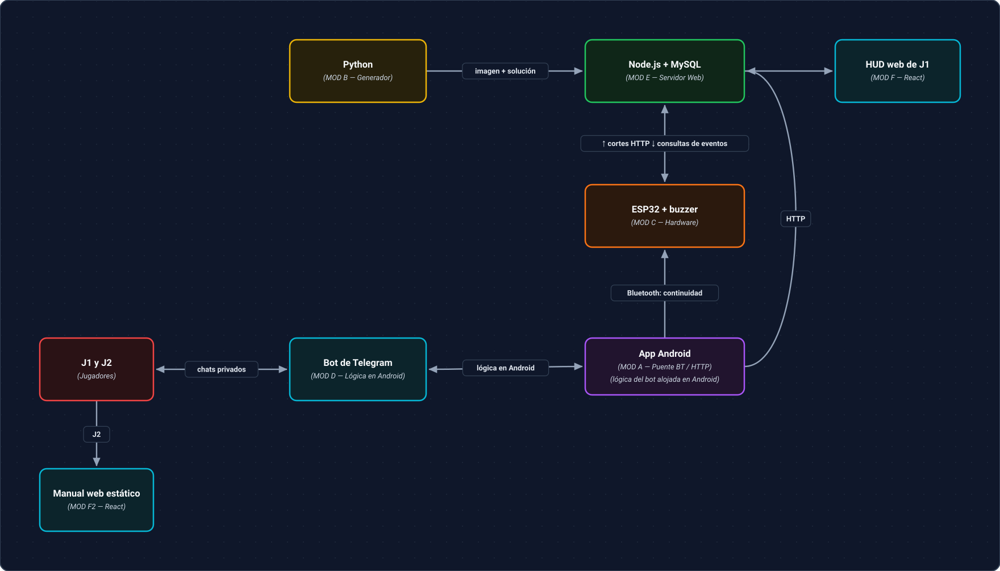

# Protobomb

Protobomb es un juego escolar cooperativo para dos personas. Una monta cinco cables en una protoboard y debe saber cuál desconectar antes de que se agote el tiempo. La otra tiene el manual para deducir la respuesta. La «explosión» del juego se representa con sonido y un mensaje de derrota.

## Cómo se juega

1. **J1** copia el armado que aparece en su pantalla. Hay cinco cables, uno de cada color: rojo, naranja, amarillo, verde y azul.
2. **J1** escribe `/inicia` en el chat privado con el bot. El teléfono comprueba por Bluetooth que los cinco cables estén conectados. Si falta alguno, el bot avisa únicamente a J1.
3. Cuando arranca la partida, el HUD de J1 oculta la imagen y muestra la cuenta regresiva. Se abre el chat a través del bot. **J2** consulta su manual y pregunta a J1 por el orden de los cables.
4. Desconectar el cable correcto da la victoria. Un corte incorrecto resta tiempo. Si el reloj llega a cero, hay derrota. El resultado se envía a ambos jugadores, se cierra el chat y el HUD muestra el siguiente armado tras una pausa.

## Arquitectura

## Estructura del modulo ARD/ESP32

## Puesta en marcha

El repositorio tiene una integración parcial. Los pasos siguientes distinguen qué se puede probar hoy y qué requiere el trabajo de los módulos.

| Paso | Qué preparar |
| --- | --- |
| 1. Servidor y BD | En `MOD E Servidor Web NodeJS/`, ejecutar `npm ci` y `node app.js` con MySQL disponible. El puerto HTTP y Socket.IO predeterminado es `3010`. El SQL versionado pertenece a ejercicios anteriores; la migración de `partida` está pendiente. |
| 2. ESP32 | Abrir `MOD C Arduino/BombaARD_POST_BTv1/BombaARD_POST_BTv1.ino` con soporte de ESP32 para Arduino. El sketch actual permite probar la continuidad y el buzzer de arranque; los cortes todavía no se validan como jugadas. |
| 3. Android y Telegram | Abrir `MOD A y D Android y Telegram/AndroidProtobomb/` en Android Studio, usar un teléfono con Bluetooth y emparejar el módulo serie. Mantener abierta la app de puente mientras se juega. Configurar un bot de prueba y los dos chats privados cuando el relay esté implementado. |
| 4. HUD de J1 | En `MOD F Cliente Web React/CLIENTE_WEB_PRE_ARMADO/my-app/`, ejecutar `npm ci` y `npm run dev`. Configurar `VITE_SERVER_URL` con la dirección del servidor. El HUD actual usa endpoints heredados y muestra tiempo transcurrido. |
| 5. Generador y manual | `MOD B Cliente python/` y `MOD F2 Cliente Web React/` todavía no tienen aplicaciones ejecutables. Sus responsables deben implementar el generador y publicar el manual antes de la primera prueba completa. |

Para la primera integración, usar una red local que permita al teléfono, al ESP32 y a los navegadores llegar al servidor. El acceso a Telegram requiere Internet. Después de implementar los módulos, abrir el HUD y el manual, dejar Python en ejecución y comprobar que aparece el armado antes de enviar `/inicia`. Los tiempos de partida, penalización y pausa final y las reglas oficiales del manual siguen pendientes.

El [índice técnico](AGENTS.md) enlaza las fichas de los siete módulos y define los contratos compartidos.
